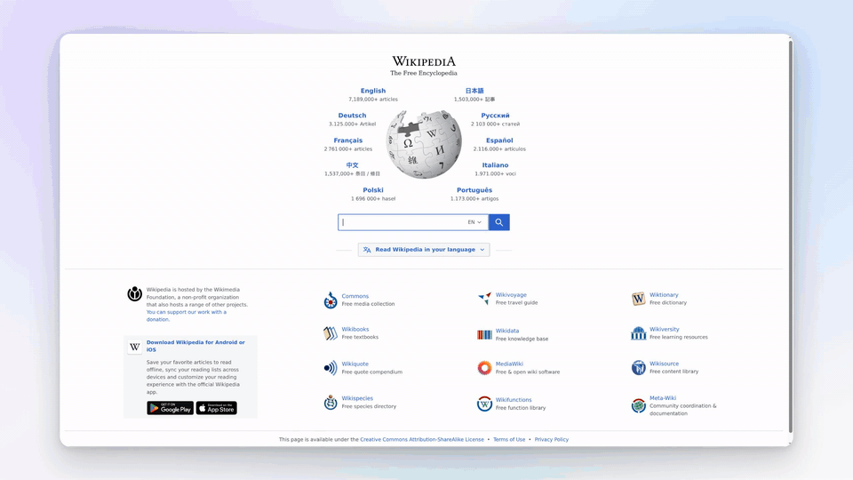

# record-demo

Agent skill + self-contained engine for recording scripted screen-capture demo videos
of any live website: Playwright drives a headed Chrome under Xvfb, ffmpeg captures,
Remotion composites cursor, zoom, spotlight and captions; outputs mp4 (raw + edited
16x9) and GIF.

See SKILL.md for usage. Engine lives in `engine/` (own pnpm workspace; `pnpm install`
once, Node >= 22.18, needs `ffmpeg`, `Xvfb`, `xdpyinfo`).

## Install

System dependencies: Node >= 22.18, `ffmpeg` with x11grab support, `Xvfb`,
`xdpyinfo`, and `pnpm`.

For Claude Code:

```bash
git clone <repo> ~/.claude/skills/record-demo
cd ~/.claude/skills/record-demo/engine
pnpm install
```

Claude Code discovers the skill automatically from the `SKILL.md` frontmatter.

For Codex and other agent CLIs:

```bash
git clone <repo> ~/.agents/skills/record-demo
cd ~/.agents/skills/record-demo/engine
pnpm install
```

`~/.agents/skills` is the shared agent-skills directory recognized by Codex, Copilot
CLI, and Gemini CLI.

### Prompt install

Paste this into your agent instead of running the commands yourself:

```text
Install the record-demo skill: clone <repo> into ~/.claude/skills/record-demo
(Claude Code) or ~/.agents/skills/record-demo (Codex / Copilot CLI / Gemini CLI),
then run `pnpm install` inside its engine/ directory. Verify Node >= 22.18,
ffmpeg, Xvfb, and xdpyinfo are available, and report anything missing.
```

## Example prompt

Once installed, ask your agent for a demo in plain language:

```text
Use the record-demo skill to record a ~20 second demo of https://en.wikipedia.org:
search for "Ada Lovelace", open the article, zoom to the lead paragraph,
spotlight the infobox portrait, then jump to a section from the contents.
Add captions for each step and finish with an outro slate. Deliver the 16x9
mp4 and a GIF.
```

The agent writes the storyboard, runs the pipeline, and returns the deliverable
paths. The clip in the next section was produced from exactly this kind of
prompt.

For authenticated staging or test sites, save the signed-in browser context as
`${XDG_STATE_HOME:-~/.local/state}/record-demo/<account>.storage-state.json` and pass
it to the recorder with `--storage-state <path>`. Treat the file as a secret: never
commit or print it, and delete it after recording.

## Example

A 23-second tour of wikipedia.org - search, suggestion click, article lead, a
focus-dim spotlight on the infobox portrait, and a contents-jump - recorded and
composited entirely by the pipeline (cursor path, zoom, spotlight, captions, end
slate, all driven by the storyboard's timeline). Storyboard:
[engine/scripts/wikipedia-tour.demo.ts](engine/scripts/wikipedia-tour.demo.ts).



Full-quality render: [media/wikipedia-tour-16x9.mp4](media/wikipedia-tour-16x9.mp4)
(2560x1440, 60fps).
